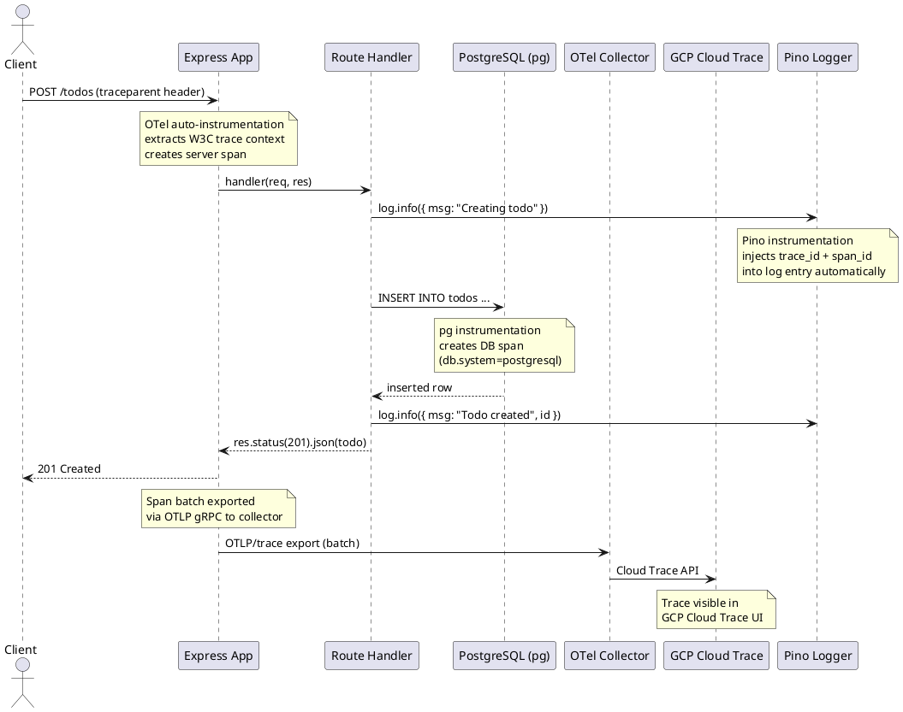

# Design Document: Todo OpenTelemetry GCP Cloud Tracing PoC

## Overview

This is a proof of concept (PoC) project that builds a simple Todo web application to demonstrate end-to-end distributed tracing with OpenTelemetry and GCP Cloud Trace. The application provides standard CRUD operations for todo items backed by a PostgreSQL database, structured JSON logging with Pino (correlated with trace IDs), and deploys on Google Kubernetes Engine (GKE) where traces are exported to GCP Cloud Trace via an OpenTelemetry Collector sidecar.

The PoC serves two purposes: (1) validate that OpenTelemetry auto-instrumentation correctly captures HTTP, Express route, and PostgreSQL database spans for a Node.js application, and (2) verify that those traces appear in GCP Cloud Trace with proper service attribution, enabling log-to-trace correlation through Pino's trace context injection.

## Architecture

The system consists of three main components: the Todo API application (Node.js/Express), a Cloud SQL for PostgreSQL database (reached directly over its private IP via Private Service Access), and an OpenTelemetry Collector running as a sidecar in the same pod. The application exports traces via OTLP (gRPC) to the collector, which then forwards them to GCP Cloud Trace using the Google Cloud Trace exporter.

### High-Level System Architecture

```plantuml
@startuml
skinparam componentStyle rectangle

component "Client / Browser" as Client
component "GKE Ingress" as Ingress
component "Todo API\nNode.js/Express" as TodoAPI
database "Cloud SQL for PostgreSQL\n(private IP)" as Postgres
component "OpenTelemetry Collector\n(Sidecar)" as OTelCollector
cloud "GCP Cloud Trace" as CloudTrace
cloud "GCP Cloud Logging" as CloudLogging
component "stdout" as Stdout

Client -->|HTTP REST| Ingress
Ingress -->|HTTP| TodoAPI
TodoAPI -->|SQL over private IP :5432| Postgres
TodoAPI -->|OTLP gRPC| OTelCollector
OTelCollector -->|Cloud Trace API| CloudTrace
TodoAPI -->|Structured JSON| Stdout
Stdout -->|captured by GKE| CloudLogging
CloudLogging ..>|trace_id correlation| CloudTrace

note "GKE Pod" as pod
note bottom of pod
  TodoAPI and OTelCollector
  run in the same pod
end note

note right of CloudTrace
  GCP Services
end note
@enduml
```

### Request Flow and Trace Propagation



### GKE Deployment Architecture

```plantuml
@startuml
node "GKE Cluster" {
  node "Namespace: todo-app" {
    node "Pod: todo-api-pod" {
      component "todo-api container\nNode.js + Express\nOTel SDK + OTLP exporter" as Container1
      component "otel-collector container\ngoogle-built collector\nCloud Trace exporter" as Container2
    }
    component "Service: todo-api-svc\nClusterIP :8080" as SVC1
  }
  component "GKE Ingress\nHTTP LoadBalancer" as Ingress
}

Ingress --> SVC1
SVC1 --> Container1
Container1 -->|OTLP gRPC localhost:4317| Container2
Container1 -->|SQL over private IP :5432| CloudSQL
Container2 -->|Cloud Trace API| CloudTrace

database "Cloud SQL for PostgreSQL" as CloudSQL

cloud "GCP Cloud Trace" as CloudTrace
@enduml
```

## Components and Interfaces

### Component 1: Todo API Application

**Purpose**: Serves the REST API for todo CRUD operations. Initializes OpenTelemetry SDK before application code loads, uses auto-instrumentation for Express, HTTP, and pg (PostgreSQL) libraries, and uses Pino for structured logging with trace context injection.

**Interface**:
```javascript
// Express application entry point
/**
 * @typedef {Object} TodoApp
 * @property {import('express').Application} app - Express application instance
 * @property {function(number): Promise<void>} start - Start the server on the given port
 * @property {function(): Promise<void>} stop - Gracefully stop the server
 */

// REST API surface (Express routes)
/**
 * @typedef {Object} TodoRoutes
 * Route handlers are async functions (req, res) => Promise<void>
 */

// POST /todos - create a new todo
// GET /todos - list all todos
// GET /todos/:id - get a single todo by ID
// PUT /todos/:id - update a todo
// DELETE /todos/:id - delete a todo
```

**Responsibilities**:
- Load OpenTelemetry SDK and register auto-instrumentations before any other module imports
- Serve Express REST endpoints for todo CRUD operations
- Execute parameterized SQL queries against PostgreSQL
- Emit structured JSON logs via Pino with automatic trace context correlation
- Export traces via OTLP gRPC to the sidecar collector

### Component 2: OpenTelemetry SDK Initialization (Tracing Setup)

**Purpose**: Configures and starts the OpenTelemetry SDK. This module MUST be imported before any application code so that auto-instrumentation can patch libraries before they are loaded.

**Interface**:
```javascript
// tracing.js - imported via --require flag before app starts
/**
 * @typedef {Object} TracingConfig
 * @property {string} serviceName           - e.g. "todo-api"
 * @property {string} otlpEndpoint           - e.g. "http://localhost:4317" (sidecar)
 * @property {Object<string, string>} resourceAttributes - service.name, service.version, deployment.environment
 */

/**
 * @typedef {Object} TracingSetup
 * @property {function(TracingConfig): void} initializeTracing
 * Registers:
 * - NodeSDK with BatchSpanProcessor (OTLP gRPC exporter)
 * - @opentelemetry/auto-instrumentations-node (Express, HTTP, pg, Pino, etc.)
 * - Resource with service.name and service.version attributes
 */
```

**Responsibilities**:
- Initialize NodeSDK with OTLP trace exporter pointing to the sidecar collector
- Register `getNodeAutoInstrumentations()` to auto-instrument Express, HTTP, pg, and Pino
- Configure batch span processor for efficient trace export (batch size, export interval)
- Set resource attributes for service identification in Cloud Trace

### Component 3: PostgreSQL Data Layer

**Purpose**: Manages database connections and executes parameterized queries for todo operations. The `pg` library is auto-instrumented by OpenTelemetry to create database spans automatically.

**Interface**:
```javascript
// db.js - PostgreSQL connection pool and query helpers
/**
 * @typedef {Object} DatabaseConfig
 * @property {string} host
 * @property {number} port
 * @property {string} database
 * @property {string} user
 * @property {string} password
 * @property {number} maxConnections  - pool size
 */

/**
 * @typedef {Object} TodoRepository
 * @property {function(CreateTodoInput): Promise<Todo>} create
 * @property {function(): Promise<Todo[]>} findAll
 * @property {function(number): Promise<Todo|null>} findById
 * @property {function(number, UpdateTodoInput): Promise<Todo|null>} update
 * @property {function(number): Promise<boolean>} delete
 */

// Database spans auto-created by pg instrumentation:
// span name: "INSERT todos" / "SELECT todos" etc.
// attributes: db.system=postgresql, db.statement, net.peer.name, net.peer.port
```

**Responsibilities**:
- Maintain a connection pool to PostgreSQL
- Execute parameterized SQL queries (prevents SQL injection)
- Return typed results to the route handlers
- Database spans are automatically created by the `pg` auto-instrumentation

### Component 4: Pino Logger with Trace Correlation

**Purpose**: Provides high-performance structured JSON logging with automatic trace context injection. The `@opentelemetry/instrumentation-pino` package (included in auto-instrumentations) automatically injects `trace_id` and `span_id` into every log entry when a span is active.

**Interface**:
```javascript
// logger.js - Pino logger factory
/**
 * @typedef {Object} LoggerConfig
 * @property {string} level          - "info" in production, "debug" in dev
 * @property {boolean} prettyPrint   - true for dev, false for GKE (JSON to stdout)
 */

// Pino logger with trace context injection enabled via OTel instrumentation
// Configured with GCP Cloud Logging compatibility:
//   - level → mapped to "severity" (string: "INFO", "WARNING", "ERROR", etc.)
//   - time → mapped to "timestamp" (ISO 8601 string, not epoch ms)
// Achieved via pino config: { level: 'info', timestamp: pino.stdTimeFunctions.isoTime,
//   formatters: { level(label) { return { severity: label.toUpperCase() } } } }
// Every log entry automatically includes:
// { severity: "INFO", timestamp: "2024-01-15T12:00:00.000Z",
//   trace_id: "abc123...", span_id: "def456...", trace_flags: "01", msg: "..." }
```

**Responsibilities**:
- Output structured JSON logs to stdout (captured by GKE and sent to Cloud Logging)
- Use GCP Cloud Logging compatible field names: `"severity"` (string, e.g. `"INFO"`) instead of Pino's default numeric `"level"`, and `"timestamp"` (ISO 8601 string) instead of epoch milliseconds `"time"`
- Automatically correlate logs with active traces via `trace_id` and `span_id` (injected by `@opentelemetry/instrumentation-pino`)
- Support configurable log levels
- The `@opentelemetry/instrumentation-pino` auto-instrumentation handles trace context injection — no manual code needed in the application

### Component 5: OpenTelemetry Collector (Sidecar)

**Purpose**: Receives OTLP trace data from the application and exports it to GCP Cloud Trace. Runs as a sidecar container in the same pod as the Todo API, authenticating via Application Default Credentials from the GKE node pool's service account (`roles/cloudtrace.agent`).

**Collector Configuration**:
```yaml
# otel-collector-config.yaml
receivers:
  otlp:
    protocols:
      grpc:
        endpoint: 0.0.0.0:4317

processors:
  batch:
    send_batch_size: 512
    timeout: 5s
  # Resource processor to add GCP-specific attributes
  resource:
    attributes:
      - key: cloud.platform
        value: gcp_kubernetes_engine
        action: upsert

exporters:
  googlecloud:
    # Credentials come from Application Default Credentials via the GKE node's
    # service account (roles/cloudtrace.agent). No explicit credentials needed.

service:
  pipelines:
    traces:
      receivers: [otlp]
      processors: [resource, batch]
      exporters: [googlecloud]
```

**Responsibilities**:
- Accept OTLP gRPC trace exports from the application on localhost:4317
- Batch spans for efficient export to Cloud Trace API
- Authenticate using the GKE node pool's service account via ADC (no manual credential files)
- Add GCP-specific resource attributes for trace attribution

## Data Models

### Model 1: Todo

```javascript
/**
 * @typedef {Object} Todo
 * @property {number} id
 * @property {string} title
 * @property {string|null} description
 * @property {boolean} completed
 * @property {string} created_at  - ISO 8601 timestamp
 * @property {string} updated_at  - ISO 8601 timestamp
 */
```

**Validation Rules**:
- `id`: auto-generated by PostgreSQL (SERIAL PRIMARY KEY)
- `title`: required, non-empty string, max 255 characters
- `description`: optional, nullable, max 1000 characters
- `completed`: boolean, defaults to `false`
- `created_at`: auto-generated by PostgreSQL (DEFAULT NOW())
- `updated_at`: auto-updated by PostgreSQL trigger or application

### Model 2: CreateTodoInput

```javascript
/**
 * @typedef {Object} CreateTodoInput
 * @property {string} title
 * @property {string|null} [description]  - optional
 */
```

**Validation Rules**:
- `title`: required, non-empty string, 1-255 characters
- `description`: optional, nullable, max 1000 characters

### Model 3: UpdateTodoInput

```javascript
/**
 * @typedef {Object} UpdateTodoInput
 * @property {string} [title]          - optional
 * @property {string|null} [description]  - optional
 * @property {boolean} [completed]    - optional
 */
```

**Validation Rules**:
- At least one field must be provided
- `title`: if provided, non-empty string, 1-255 characters
- `description`: if provided, nullable, max 1000 characters
- `completed`: if provided, boolean

### Model 4: API Error Response

```javascript
/**
 * @typedef {Object} ErrorResponse
 * @property {Object} error
 * @property {string} error.code     - e.g. "NOT_FOUND", "VALIDATION_ERROR", "INTERNAL_ERROR"
 * @property {string} error.message
 */
// Note: trace_id is NOT manually added here — Pino instrumentation
// adds it to the log entry automatically, and the response
// includes the trace_id in headers (x-cloud-trace-context is GCP-native,
// but OTel propagation uses W3C traceparent)
```

### Database Schema

```sql
CREATE TABLE IF NOT EXISTS todos (
  id SERIAL PRIMARY KEY,
  title VARCHAR(255) NOT NULL,
  description TEXT,
  completed BOOLEAN NOT NULL DEFAULT FALSE,
  created_at TIMESTAMPTZ NOT NULL DEFAULT NOW(),
  updated_at TIMESTAMPTZ NOT NULL DEFAULT NOW()
);

CREATE INDEX IF NOT EXISTS idx_todos_completed ON todos(completed);
```

## Key Functions with Formal Specifications

### Function 1: initializeTracing()

```javascript
// tracing.js
/**
 * Initializes the OpenTelemetry SDK.
 * @param {TracingConfig} config - Tracing configuration
 * @returns {void}
 */
function initializeTracing(config) { /* ... */ }
```

**Preconditions:**
- `config.serviceName` is a non-empty string
- `config.otlpEndpoint` is a valid URI (e.g., `http://localhost:4317`)
- This function is called before any other module that uses instrumented libraries is imported (achieved via `--require ./tracing.js`)

**Postconditions:**
- A global `TracerProvider` is registered
- `BatchSpanProcessor` is configured with OTLP gRPC exporter pointing to `config.otlpEndpoint`
- `getNodeAutoInstrumentations()` is registered, enabling automatic spans for Express, HTTP, pg, and Pino
- Resource attributes include `service.name`, `service.version`, and `deployment.environment`
- All subsequently loaded instrumented libraries produce spans automatically

**Loop Invariants:** N/A (no loops)

### Function 2: createTodo()

```javascript
// routes/todos.js
/**
 * POST /todos - create a new todo
 * @param {import('express').Request} req
 * @param {import('express').Response} res
 * @returns {Promise<void>}
 */
async function createTodo(req, res) { /* ... */ }
```

**Preconditions:**
- `req.body` exists and contains `title` (string, non-empty, 1-255 chars)
- `req.body.description` if present is a string or null, max 1000 chars
- Database connection pool is initialized and healthy
- An active span exists (auto-created by Express instrumentation for this route)

**Postconditions:**
- On success: `res.status(201)` is called with a JSON body matching `Todo`, including the newly assigned `id`
- On validation failure: `res.status(400)` is called with an `ErrorResponse` body
- On database error: `res.status(500)` is called with an `ErrorResponse` body
- No partial database writes occur on error (parameterized query is atomic)
- The active span has attributes: `http.method=POST`, `http.route=/todos`, `http.status_code=201|400|500`

**Loop Invariants:** N/A (no loops)

### Function 3: listTodos()

```javascript
// routes/todos.js
/**
 * GET /todos - list all todos
 * @param {import('express').Request} req
 * @param {import('express').Response} res
 * @returns {Promise<void>}
 */
async function listTodos(req, res) { /* ... */ }
```

**Preconditions:**
- Database connection pool is initialized and healthy
- An active span exists (auto-created by Express instrumentation)

**Postconditions:**
- On success: `res.status(200)` is called with a JSON array of `Todo` objects
- On database error: `res.status(500)` is called with an `ErrorResponse` body
- The database span (auto-created by pg instrumentation) has attributes: `db.system=postgresql`, `db.statement=SELECT * FROM todos ORDER BY created_at DESC`

**Loop Invariants:** N/A (no loops)

### Function 4: getTodo()

```javascript
// routes/todos.js
/**
 * GET /todos/:id - get a single todo by ID
 * @param {import('express').Request} req
 * @param {import('express').Response} res
 * @returns {Promise<void>}
 */
async function getTodo(req, res) { /* ... */ }
```

**Preconditions:**
- `req.params.id` exists and is parseable as a positive integer
- Database connection pool is initialized and healthy
- An active span exists

**Postconditions:**
- On success (todo found): `res.status(200)` with `Todo` JSON body
- On not found: `res.status(404)` with `ErrorResponse` body (code: "NOT_FOUND")
- On invalid ID format: `res.status(400)` with `ErrorResponse` body (code: "VALIDATION_ERROR")
- The database span has attributes: `db.system=postgresql`, `db.statement=SELECT * FROM todos WHERE id = $1`

**Loop Invariants:** N/A (no loops)

### Function 5: updateTodo()

```javascript
// routes/todos.js
/**
 * PUT /todos/:id - update a todo
 * @param {import('express').Request} req
 * @param {import('express').Response} res
 * @returns {Promise<void>}
 */
async function updateTodo(req, res) { /* ... */ }
```

**Preconditions:**
- `req.params.id` exists and is parseable as a positive integer
- `req.body` contains at least one of: `title`, `description`, `completed`
- If `title` is provided, it is a non-empty string, 1-255 chars
- Database connection pool is initialized and healthy
- An active span exists

**Postconditions:**
- On success: `res.status(200)` with updated `Todo` JSON body, `updated_at` reflects current time
- On not found: `res.status(404)` with `ErrorResponse` body
- On validation failure: `res.status(400)` with `ErrorResponse` body
- The update is atomic (single SQL UPDATE statement with RETURNING clause)

**Loop Invariants:** N/A (no loops)

### Function 6: deleteTodo()

```javascript
// routes/todos.js
/**
 * DELETE /todos/:id - delete a todo
 * @param {import('express').Request} req
 * @param {import('express').Response} res
 * @returns {Promise<void>}
 */
async function deleteTodo(req, res) { /* ... */ }
```

**Preconditions:**
- `req.params.id` exists and is parseable as a positive integer
- Database connection pool is initialized and healthy
- An active span exists

**Postconditions:**
- On success: `res.status(204)` with no response body
- On not found: `res.status(404)` with `ErrorResponse` body
- On invalid ID format: `res.status(400)` with `ErrorResponse` body

**Loop Invariants:** N/A (no loops)

### Function 7: validateTodoInput()

```javascript
// validation.js
/**
 * Validates the request body for creating a todo.
 * @param {unknown} body - The request body to validate
 * @returns {{ valid: boolean, errors: string[], data?: CreateTodoInput }}
 */
function validateCreateTodoInput(body) { /* ... */ }

/**
 * Validates the request body for updating a todo.
 * @param {unknown} body - The request body to validate
 * @returns {{ valid: boolean, errors: string[], data?: UpdateTodoInput }}
 */
function validateUpdateTodoInput(body) { /* ... */ }
```

**Preconditions:**
- `body` is defined (not null/undefined)

**Postconditions:**
- Returns an object with `valid` (boolean), `errors` (string[]), and optional `data`
- `valid === true` if and only if all validation rules pass
- `errors` array is empty when `valid === true`, non-empty when `valid === false`
- `data` is populated with the validated input when `valid === true`
- No mutations to the input `body` parameter

**Loop Invariants:**
- For field validation loops: all previously validated fields remain valid when the loop continues

### Function 8: createPool()

```javascript
// db.js
/**
 * Creates a PostgreSQL connection pool.
 * @param {DatabaseConfig} config - Database connection configuration
 * @returns {import('pg').Pool}
 */
function createPool(config) { /* ... */ }
```

**Preconditions:**
- `config.host` is a non-empty string
- `config.port` is a valid port number (1-65535)
- `config.database`, `config.user`, `config.password` are non-empty strings
- `config.maxConnections` is a positive integer (recommended: 10 for PoC)

**Postconditions:**
- Returns a `pg.Pool` instance with the specified configuration
- The pool is ready to accept connections
- Connection lifecycle is managed by the pool (connections created on demand, reused)

**Loop Invariants:** N/A (no loops)

## Algorithmic Pseudocode

### Main Application Startup Algorithm

```pascal
ALGORITHM startApplication(config)
INPUT: config of type AppConfig (port, dbConfig, tracingConfig)
OUTPUT: server of type http.Server

BEGIN
  // Step 1: Initialize OpenTelemetry BEFORE loading app modules
  // This is achieved via: node --require ./tracing.js ./app.js
  ASSERT tracingInitialized = true

  // Step 2: Initialize Pino logger
  logger ← createLogger({ level: config.logLevel, prettyPrint: config.isDev })
  logger.info({ msg: "Starting Todo API", version: config.version })

  // Step 3: Create database connection pool
  pool ← createPool(config.dbConfig)
  ASSERT pool != null

  // Step 4: Run database migrations
  success ← runMigrations(pool)
  IF NOT success THEN
    logger.error({ msg: "Database migration failed" })
    THROW DatabaseMigrationError
  END IF

  // Step 5: Create Express application with middleware
  app ← express()
  app.use(express.json())
  app.use(requestLogger(logger))   // Pino HTTP middleware

  // Step 6: Register routes
  registerTodoRoutes(app, pool, logger)

  // Step 7: Start HTTP server
  server ← app.listen(config.port)
  logger.info({ msg: "Todo API started", port: config.port })

  RETURN server
END
```

**Preconditions:**
- `config` is fully populated with valid values
- OpenTelemetry tracing is initialized (via --require flag)
- PostgreSQL database is reachable and accepting connections

**Postconditions:**
- HTTP server is listening on `config.port`
- Database migrations have been applied
- All Express routes are registered and instrumented

### Request Processing Algorithm (POST /todos)

```pascal
ALGORITHM handleCreateTodoRequest(req, res, pool, logger)
INPUT: req (HTTP request with body), res (HTTP response), pool (DB pool), logger (Pino)
OUTPUT: void (sends HTTP response)

BEGIN
  // Span auto-created by Express instrumentation: name="POST /todos"
  ASSERT activeSpan != null

  // Step 1: Parse and validate request body
  validationResult ← validateCreateTodoInput(req.body)
  IF NOT validationResult.valid THEN
    logger.warn({ msg: "Validation failed", errors: validationResult.errors })
    res.status(400).json({ error: { code: "VALIDATION_ERROR", message: validationResult.errors.join(", ") } })
    activeSpan.setAttribute("http.status_code", 400)
    RETURN
  END IF

  // Step 2: Create custom span for business logic
  tracer ← trace.getTracer("todo-api")
  WITH span ← tracer.startSpan("todo.create") DO
    span.setAttribute("todo.title", validationResult.data.title)

    // Step 3: Execute database query (pg auto-instrumentation creates child span)
    logger.info({ msg: "Creating todo", title: validationResult.data.title })
    todo ← pool.query(
      "INSERT INTO todos (title, description) VALUES ($1, $2) RETURNING *",
      [validationResult.data.title, validationResult.data.description]
    )

    // Step 4: Return created todo
    logger.info({ msg: "Todo created", id: todo.rows[0].id })
    span.setAttribute("todo.id", todo.rows[0].id)
    res.status(201).json(todo.rows[0])
    activeSpan.setAttribute("http.status_code", 201)
  END WITH

EXCEPT
  ON DatabaseError DO
    logger.error({ msg: "Database error", error: error.message })
    activeSpan.recordException(error)
    activeSpan.setAttribute("http.status_code", 500)
    res.status(500).json({ error: { code: "INTERNAL_ERROR", message: "Database error" } })

  ON OtherError DO
    logger.error({ msg: "Unexpected error", error: error.message })
    activeSpan.recordException(error)
    activeSpan.setAttribute("http.status_code", 500)
    res.status(500).json({ error: { code: "INTERNAL_ERROR", message: "Internal server error" } })
END
```

**Preconditions:**
- `req` is a valid Express Request with JSON body
- `res` is a valid Express Response
- `pool` is an initialized and healthy PostgreSQL connection pool
- `logger` is a Pino logger instance with trace context injection enabled
- An active span exists (created by Express auto-instrumentation)

**Postconditions:**
- Exactly one HTTP response is sent (`res.status()` called exactly once)
- On success: response status is 201, body is the created Todo object
- On validation error: response status is 400, body contains error details
- On database error: response status is 500, body contains generic error message
- The active span has `http.status_code` attribute set
- Database errors are recorded on the active span via `recordException()`

**Loop Invariants:** N/A (no loops)

### Trace Export Pipeline Algorithm

```pascal
ALGORITHM exportTraces(spans, otlpEndpoint)
INPUT: spans (array of Span objects), otlpEndpoint (URI string)
OUTPUT: void (asynchronous, fire-and-forget with retry)

BEGIN
  // Step 1: Batch spans for export
  FOR each span IN spans DO
    ASSERT span.endTime != null    // span must be ended before export
    batch.add(span)
  END FOR

  // Step 2: Export batch when size threshold or timeout reached
  IF batch.size >= BATCH_SIZE OR batch.age >= BATCH_TIMEOUT THEN
    TRY
      // OTLP gRPC export to sidecar collector
      otlpExporter.export(batch)
      batch.clear()
    EXCEPT
      ON ExportError DO
        // Retry with exponential backoff (handled by SDK)
        log.warn("Trace export failed, will retry", error)
        // SDK automatically retries with backoff
    END TRY
  END IF
END
```

**Preconditions:**
- All spans in the batch have been ended (have `endTime` set)
- `otlpEndpoint` is reachable (sidecar collector is running)

**Postconditions:**
- Span batches are exported to the OTLP endpoint when threshold is met
- Failed exports are retried by the SDK with exponential backoff
- No spans are lost during normal operation (batch processor buffers in memory)

**Loop Invariants:**
- All spans added to the batch have been ended before export
- Batch size only grows between exports; cleared after successful export

## Example Usage

### Starting the Application with Tracing

```javascript
// package.json scripts
// "start": "node --require ./tracing.js ./app.js"
// The --require flag ensures OTel SDK loads before app modules

// tracing.js - OpenTelemetry initialization
const { NodeSDK } = require('@opentelemetry/sdk-node');
const { OTLPTraceExporter } = require('@opentelemetry/exporter-trace-otlp-grpc');
const { getNodeAutoInstrumentations } = require('@opentelemetry/auto-instrumentations-node');
const { resourceFromAttributes } = require('@opentelemetry/resources');

function initializeTracing() {
  const sdk = new NodeSDK({
    resource: resourceFromAttributes({
      'service.name': 'todo-api',
      'service.version': '1.0.0',
      'deployment.environment': process.env.NODE_ENV || 'development',
    }),
    traceExporter: new OTLPTraceExporter({
      url: process.env.OTEL_EXPORTER_OTLP_ENDPOINT || 'http://localhost:4317',
    }),
    instrumentations: [getNodeAutoInstrumentations({
      '@opentelemetry/instrumentation-fs': { enabled: false },  // disable noisy fs instrumentation
    })],
  });

  sdk.start();
}

module.exports = { initializeTracing };

// app.js - Express application
const express = require('express');
const pino = require('pino');
const { Pool } = require('pg');

const logger = pino({
  level: process.env.LOG_LEVEL || 'info',
  // GCP Cloud Logging compatibility: ISO 8601 timestamp + string severity
  timestamp: pino.stdTimeFunctions.isoTime,
  formatters: {
    level(label) {
      return { severity: label.toUpperCase() };
    },
  },
});
const pool = new Pool({
  host: process.env.DB_HOST || 'localhost',
  port: parseInt(process.env.DB_PORT || '5432'),
  database: process.env.DB_NAME || 'todos',
  user: process.env.DB_USER || 'postgres',
  password: process.env.DB_PASSWORD || 'postgres',
  max: 10,
});

const app = express();
app.use(express.json());

// POST /todos
app.post('/todos', async (req, res) => {
  const { title, description } = req.body;
  if (!title || title.length < 1 || title.length > 255) {
    logger.warn({ msg: 'Validation failed', field: 'title' });
    return res.status(400).json({
      error: { code: 'VALIDATION_ERROR', message: 'Title is required (1-255 chars)' }
    });
  }

  logger.info({ msg: 'Creating todo', title });
  const result = await pool.query(
    'INSERT INTO todos (title, description) VALUES ($1, $2) RETURNING *',
    [title, description || null]
  );

  logger.info({ msg: 'Todo created', id: result.rows[0].id });
  res.status(201).json(result.rows[0]);
});

// GET /todos
app.get('/todos', async (req, res) => {
  const result = await pool.query('SELECT * FROM todos ORDER BY created_at DESC');
  res.json(result.rows);
});

// GET /todos/:id
app.get('/todos/:id', async (req, res) => {
  const id = parseInt(req.params.id);
  if (isNaN(id) || id < 1) {
    return res.status(400).json({
      error: { code: 'VALIDATION_ERROR', message: 'Invalid ID format' }
    });
  }
  const result = await pool.query('SELECT * FROM todos WHERE id = $1', [id]);
  if (result.rows.length === 0) {
    return res.status(404).json({
      error: { code: 'NOT_FOUND', message: `Todo with id ${id} not found` }
    });
  }
  res.json(result.rows[0]);
});

// PUT /todos/:id
app.put('/todos/:id', async (req, res) => {
  const id = parseInt(req.params.id);
  const { title, description, completed } = req.body;
  const result = await pool.query(
    `UPDATE todos SET
       title = COALESCE($1, title),
       description = COALESCE($2, description),
       completed = COALESCE($3, completed),
       updated_at = NOW()
     WHERE id = $4 RETURNING *`,
    [title, description, completed, id]
  );
  if (result.rows.length === 0) {
    return res.status(404).json({
      error: { code: 'NOT_FOUND', message: `Todo with id ${id} not found` }
    });
  }
  res.json(result.rows[0]);
});

// DELETE /todos/:id
app.delete('/todos/:id', async (req, res) => {
  const id = parseInt(req.params.id);
  const result = await pool.query('DELETE FROM todos WHERE id = $1', [id]);
  if (result.rowCount === 0) {
    return res.status(404).json({
      error: { code: 'NOT_FOUND', message: `Todo with id ${id} not found` }
    });
  }
  res.status(204).send();
});

const PORT = parseInt(process.env.PORT || '8080');
app.listen(PORT, () => {
  logger.info({ msg: 'Todo API started', port: PORT });
});
```

### Example Log Output (with Trace Context)

The Pino logger must be configured for GCP Cloud Logging compatibility. By default, Pino outputs `"level"` as a numeric value (e.g., `30`) and `"time"` as epoch milliseconds. Cloud Logging expects `"severity"` as a string (e.g., `"INFO"`) and a `"timestamp"` in ISO 8601 format. The logger configuration maps Pino's fields to GCP's expected format:

```javascript
// logger.js - GCP Cloud Logging compatible Pino configuration
const pino = require('pino');

const logger = pino({
  level: process.env.LOG_LEVEL || 'info',
  // Use ISO 8601 timestamp instead of epoch milliseconds
  timestamp: pino.stdTimeFunctions.isoTime,
  // Map numeric level to GCP severity string
  formatters: {
    level(label) {
      return { severity: label.toUpperCase() };
    },
  },
});

module.exports = logger;
```

Resulting log output (GCP Cloud Logging compatible):

```json
{
  "severity": "INFO",
  "timestamp": "2024-01-15T12:00:00.000Z",
  "pid": 1,
  "hostname": "todo-api-pod-abc123",
  "trace_id": "abcdef1234567890fedcba0987654321",
  "span_id": "1234567890abcdef",
  "trace_flags": "01",
  "msg": "Creating todo",
  "title": "Buy groceries"
}
```

> **Note**: The `"trace_id"` and `"span_id"` fields are automatically injected by `@opentelemetry/instrumentation-pino`. The `"severity"` (string, uppercase) and `"timestamp"` (ISO 8601) fields are required by GCP Cloud Logging to correctly parse log levels and timestamps. GCP Cloud Logging uses the `trace_id` field to link log entries to Cloud Trace spans.

### Example Trace in GCP Cloud Trace

When viewing a trace in Cloud Trace, the waterfall shows:
1. `POST /todos` (Express route span, ~2ms)
2. └─ `todo.create` (custom business logic span, ~1ms)
3.    └─ `INSERT todos` (pg database span, ~15ms, attributes: `db.system=postgresql`)

## Correctness Properties

### Property 1: Trace ID Correlation

**Statement**: For every HTTP request that results in at least one log entry, the log entry's `trace_id` field matches the `trace_id` of the span created for that HTTP request.

**Verification**: Make a request to `POST /todos`. In the application logs (stdout), find the log entry for "Creating todo". Extract the `trace_id` from that log entry. In GCP Cloud Trace, search for that `trace_id`. The trace must exist and contain the `POST /todos` server span.

### Property 2: Span Hierarchy for Database Operations

**Statement**: Every database span created by the `pg` auto-instrumentation is a child span of the Express route handler span for the request that triggered the database operation.

**Verification**: Make a request to `GET /todos`. In Cloud Trace, the trace must show the `GET /todos` span as the parent and the `SELECT todos` span as its child. The parent-child relationship is established via the OTel context propagation.

### Property 3: All CRUD Endpoints Produce Traces

**Statement**: Each of the five CRUD endpoints (POST, GET list, GET by ID, PUT, DELETE) produces at least one trace in Cloud Trace when called successfully.

**Verification**: Call each endpoint. Each call must produce a visible trace in Cloud Trace with the correct HTTP method and route attributes.

### Property 4: Error Traces Include Exception Attributes

**Statement**: When a request results in a 500 error (e.g., database unavailable), the corresponding trace span includes exception information via `recordException()`.

**Verification**: Temporarily make the database unreachable. Send a request to `GET /todos`. The trace in Cloud Trace must show the span with an exception status and error attributes.

### Property 5: Trace Context Propagation via W3C Traceparent

**Statement**: When a client sends a request with a `traceparent` header (W3C Trace Context format), the application's server span continues the same trace rather than starting a new one.

**Verification**: Generate a traceparent header with a known trace_id. Send a request with that header. The trace in Cloud Trace must use the same trace_id, and the server span must be a child of the propagated trace.

### Property 6: No Traces Lost During Normal Operation

**Statement**: Under normal operation (collector available, no memory pressure), every span created by the application is exported to Cloud Trace within the batch export interval (default 5 seconds).

**Verification**: Send 10 requests. Count the spans in Cloud Trace. The count must equal or exceed the expected number (10 server spans + database spans + custom spans).

## Error Handling

### Error Scenario 1: Database Connection Failure

**Condition**: PostgreSQL is unreachable when the application starts or during operation.
**Response**: The `pg.Pool` will throw a connection error. The route handler catches this, logs the error via Pino (with trace_id), calls `span.recordException(error)`, sets the span status to ERROR, and returns a 500 response.
**Recovery**: The connection pool automatically retries connections. When PostgreSQL becomes available, new connections are established without restarting the application.

### Error Scenario 2: OTLP Exporter Unreachable (Collector Down)

**Condition**: The OpenTelemetry Collector sidecar is not running or unreachable on localhost:4317.
**Response**: The `BatchSpanProcessor` will buffer spans in memory and retry exports with exponential backoff. The application continues to serve requests normally — tracing failure does NOT affect application availability.
**Recovery**: When the collector comes back online, buffered spans are exported. If the buffer fills up (memory pressure), oldest spans are dropped and a warning is logged.

### Error Scenario 3: Invalid Request Body

**Condition**: A client sends a request with missing or invalid fields (e.g., empty title, title exceeding 255 chars).
**Response**: The validation function returns `{ valid: false, errors: [...] }`. The route handler returns a 400 response with an `ErrorResponse` body listing the validation errors.
**Recovery**: The client can correct the request and retry. No database operations are performed for invalid requests.

### Error Scenario 4: Todo Not Found

**Condition**: A client requests, updates, or deletes a todo with an ID that does not exist in the database.
**Response**: The database query returns zero rows. The route handler returns a 404 response with an `ErrorResponse` body (code: "NOT_FOUND").
**Recovery**: No recovery needed — this is expected application behavior for valid but non-existent resources.

### Error Scenario 5: Node Service Account Misconfigured

**Condition**: The GKE node pool's service account does not have the `roles/cloudtrace.agent` IAM role, or the node pool lacks the `cloud-platform`/`trace.append` access scope.
**Response**: The collector cannot authenticate to the Cloud Trace API. Traces are not exported to Cloud Trace, but the application continues to function normally.
**Recovery**: Grant `roles/cloudtrace.agent` to the node pool's service account and ensure the node pool has the `cloud-platform` (or `trace.append`) access scope (recreate the node pool if scopes must change). Restart the pod.

## Testing Strategy

### Unit Testing Approach

Unit tests cover validation logic and business logic functions that do not require database or network access:

- **Validation tests**: Test `validateCreateTodoInput` and `validateUpdateTodoInput` with valid inputs, invalid inputs (empty title, oversized title, missing fields), and edge cases (null, undefined, wrong types).
- **Response formatting tests**: Test that error responses conform to the `ErrorResponse` structure.
- **Configuration tests**: Test that `TracingConfig` parsing handles environment variables correctly.

**Coverage goal**: 90%+ for validation and utility modules.

### Property-Based Testing Approach

Use property-based testing to verify invariants of the validation functions and the CRUD lifecycle:

**Property Test Library**: fast-check

**Properties to test**:
1. For any valid `CreateTodoInput`, `validateCreateTodoInput` returns `{ valid: true, data: <input> }` with no mutations to the input.
2. For any string longer than 255 characters as title, `validateCreateTodoInput` returns `{ valid: false }`.
3. For any `UpdateTodoInput` with all fields undefined/absent, `validateUpdateTodoInput` returns `{ valid: false }` (at least one field required).
4. For any valid todo, the create → get → update → delete lifecycle returns consistent data at each step.

### Integration Testing Approach

Integration tests verify the complete request-to-trace pipeline:

1. **API integration tests**: Start the application with a test PostgreSQL instance. Make HTTP requests to each CRUD endpoint and verify response status codes and bodies. Use `supertest` for HTTP testing.
2. **Tracing integration tests**: Start the application with a mock OTLP collector (or the OpenTelemetry Collector in-memory exporter). Make HTTP requests and verify that spans are produced with the correct names, attributes, and parent-child relationships.
3. **Log correlation tests**: Make HTTP requests and capture stdout logs. Verify that log entries contain `trace_id` and `span_id` fields matching the produced traces.
4. **End-to-end test (manual)**: Deploy to GKE, make requests, and verify traces appear in Cloud Trace UI with the correct service name and span hierarchy.

## Performance Considerations

- **Connection pooling**: PostgreSQL pool size of 10 connections is sufficient for a PoC. Monitor pool utilization if extending.
- **Batch span processor**: Default batch size (512 spans) and export timeout (5s) balance latency vs. throughput. Spans are exported asynchronously and do not block the request path.
- **Pino logger**: Pino is asynchronous and uses minimal CPU per log entry. Pretty-print is disabled in production (JSON to stdout) for performance and Cloud Logging compatibility.
- **Auto-instrumentation overhead**: The overhead of OpenTelemetry auto-instrumentation is typically <5% of request latency for I/O-bound applications. Database spans add negligible overhead since `pg` instrumentation only wraps query execution.
- **Sidecar collector**: Running the collector as a sidecar adds ~50MB memory overhead per pod. For a PoC with a single pod, this is acceptable. For production with many pods, a DaemonSet or gateway deployment pattern would be more efficient.

## Security Considerations

- **Parameterized queries**: All SQL queries use parameterized inputs (`$1`, `$2`, etc.) to prevent SQL injection. No string concatenation is used for query construction.
- **Input validation**: All request bodies are validated before database operations. Title length, description length, and field types are checked.
- **Node service account**: The collector authenticates to Cloud Trace with the GKE node pool's service account via Application Default Credentials, avoiding key files in the container image. Note that all pods on the node share this identity.
- **Private IP database access**: Cloud SQL is reached over its private IP within the VPC (Private Service Access); it is not exposed on a public IP.
- **No secrets in code**: Database credentials and configuration are provided via environment variables (Kubernetes Secrets), not hardcoded in application code.
- **Log content**: Pino logs do not include sensitive data. Only todo content (title, description) is logged, which is user-provided data in a PoC context. In production, consider redacting PII.
- **Collector authentication**: The collector uses the node's service account (via the metadata server and ADC) to authenticate to Cloud Trace API. No explicit credentials are passed in the collector config.

## Dependencies

### Application Dependencies (package.json)

| Package | Purpose | Version (indicative) |
|---------|---------|---------------------|
| `express` | Web framework for REST API | ^4.18 |
| `pg` | PostgreSQL client for Node.js | ^8.11 |
| `pino` | High-performance structured logger | ^9.0 |
| `pino-http` | HTTP request logging middleware for Pino | ^9.0 |

### OpenTelemetry Dependencies

| Package | Purpose | Version (indicative) |
|---------|---------|---------------------|
| `@opentelemetry/sdk-node` | OpenTelemetry SDK for Node.js | ^0.200+ |
| `@opentelemetry/auto-instrumentations-node` | Auto-instrumentation for Express, HTTP, pg, Pino | ^0.60+ |
| `@opentelemetry/exporter-trace-otlp-grpc` | OTLP gRPC trace exporter | ^0.200+ |
| `@opentelemetry/resources` | Resource attributes (service.name, etc.) | ^1.x |

### Infrastructure Dependencies

| Dependency | Purpose |
|-----------|---------|
| PostgreSQL 15+ | Database for todo storage |
| Google Kubernetes Engine (GKE) | Container orchestration |
| OpenTelemetry Collector (google-built) | Trace pipeline sidecar |
| GCP Cloud Trace | Distributed tracing backend |
| GCP Cloud Logging | Structured log aggregation |
| GKE node pool service account | Authentication to Cloud Trace via ADC (`roles/cloudtrace.agent`) |
| Cloud SQL private IP (Private Service Access) | Private connectivity from GKE (VPC-native) to PostgreSQL |

### Development Dependencies

| Package | Purpose |
|-----------|---------|
| `vitest` | Test framework |
| `supertest` | HTTP integration testing |
| `fast-check` | Property-based testing |
